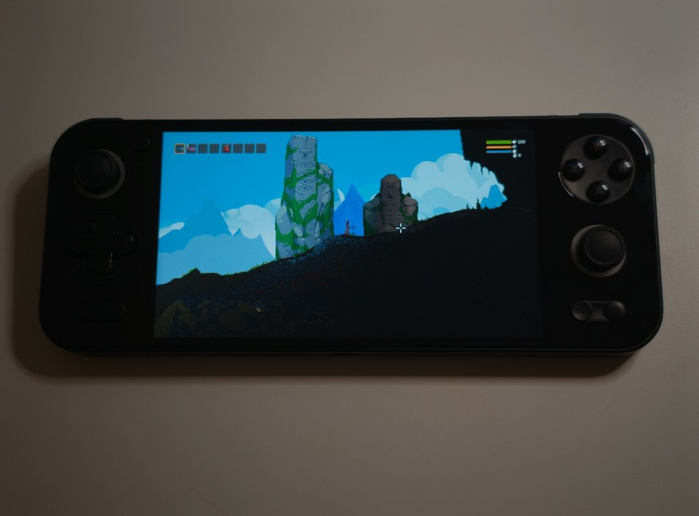

# noitadroid

**Noita on Android, natively.** noitadroid is a native Android port of Noita: the Windows game, statically
recompiled to ARM64, on Android handhelds and phones. It has no emulator and no Wine or Proton. It's built on
[mina4mac](https://github.com/paulstraw/mina4mac), which does the same for Apple Silicon Macs.

[中文说明](README.zh-CN.md)

> **This is a fork of [zhouwuqi/noitadroid](https://github.com/zhouwuqi/noitadroid)** (all the port is
> zhouwuqi's work). It also takes **the Steam version** of Noita of Jan 25 2025, besides GOG's build
> `20250125-1640`: put your Steam copy's game folder on the device and choose its `noita.exe`. The Steam build is
> stubbed offline like GOG's (no achievements, no Workshop). The speed data in `tools/` was recorded on GOG's build;
> `tools/map_build.py` maps it onto the Steam build's addresses (`tools/*_steam.*`: 99.4% of the functions matched,
> each pair byte for byte apart from addresses), so both builds get it (`tools/game_build.py`). The app installs beside
> the original (`io.github.the412banner.noitadroid`), signed with the fork's own key (SHA-256
> `02:9F:5A:9A:E2:0A:8C:E3:4D:70:48:DF:96:B2:AE:FD:E6:02:2B:81:C1:15:9F:5A:F3:9E:18:CC:E1:CC:68:78`).
>
> Its first screen lists the copies it finds on the device (GOG's installer, game folders with `noita.exe` in
> Download, Winlator's games folder, Games or the top of the storage) and you pick one, or choose a file. The sound
> step has **Download FMOD**: FMOD 2.01.23 for Android from this fork's
> [Fmod release](https://github.com/The412Banner/noitadroid/releases/tag/Fmod), checked by its sha256. That's the
> only thing the app downloads.



It plays on an AYANEO Pocket S (Snapdragon G3x Gen 2, Android 13):
- Fullscreen 1920×1080, with 50–60 fps in the early caves.
- Full sound (FMOD), and the built-in gamepad and the touchscreen both work.
- On-screen touch controls, for phones: sticks and buttons you can lay out yourself, out of the way in menus and the
  inventory. Also tried on an OPPO Find X9 Ultra (Snapdragon 8 Elite Gen 5, Android 16).
- An in-game menu with save export/import, gamepad button swaps, performance settings, and an FPS and temperature
  display.

Other devices are untested so far. Reports are welcome.

> **The APK contains no game code.** You bring **your own copy of Noita from GOG**, and the app builds the game's
> native code from it, on your device: about 20 minutes, once. That code is made from the game, so it stays on your
> device: never share it. Nothing is downloaded or uploaded.

## Install

You need:
- **Noita for Windows from GOG**, build `20250125-1640` (Jan 25 2025): its offline installer,
  `setup_noita_20250125-1640_(79502).exe` (one 1.5 GB file). The Steam version won't work: the recompiled code is
  for this one build.
- **An Android device:** arm64, Android 11 or later, OpenGL ES 3.0. The build needs a lot of memory: 8 GB of RAM or
  more is recommended (tested with 16 GB). About 5 GB of free storage while installing, 2 GB afterwards. A gamepad is
  recommended.
- **Optional, for sound:** FMOD Engine **2.01.x** for Android, which you download yourself from
  [fmod.com](https://www.fmod.com/download) (a free account): its license doesn't allow the app to include it.
  Without it, the game runs silently.

Then:
1. **Install the APK** from [Releases](https://github.com/zhouwuqi/noitadroid/releases/latest).
2. **Put GOG's installer on the device**, in the Download folder (or at the top of a memory card). If you'd rather
   copy an installed Noita folder (the one with `noita.exe`), put it in `Internal storage/noitadroid/Noita`, or
   anywhere and choose its `noita.exe` in the app.
3. **Open Noita (noitadroid).** Its first screen shows what's still missing:
   1. **All files access.** The app reads the game from shared storage and keeps saves there.
   2. **Install from it.** The app unpacks the installer into `Internal storage/noitadroid/Noita` (1–3 minutes), then
      builds the game's code (about 16 minutes on a Snapdragon G3x Gen 2). The processor runs at full speed and the
      device gets hot: plug in the charger and take it out of its case. You can use other apps meanwhile, but don't
      close Noita from the recent apps. If the build stops, the next one goes on where it left off. Afterwards the app
      offers to delete the installer.
   3. **Sound (optional).** Download **FMOD Engine 2.01.23 for Android** (`fmodstudioapi20123android.tar.gz`; pick
      2.01.23 in fmod.com's version list), put it in Download, and tap **Import**. The app restarts.
4. **Start Noita.** From then on, the app goes straight into the game.

An update of the app may ask to build the game's code again, when the code it needs has changed.

The APKs are signed with this certificate (SHA-256):
`1A:5E:5E:78:98:01:E1:48:15:EB:19:62:95:7B:F1:65:13:F3:97:BB:97:FF:EC:45:DC:D4:5D:8D:98:7B:51:F5`.

## How it works

- **The game.** mina4mac's recompiler turns the 32-bit x86 `noita.exe` (and `msvcp120.dll`) into C, and clang
  compiles that C to ARM64.
- **On the device.** The app carries its own toolchain: clang and lld (LLVM 21), Python 3.14 for the recompiler, and
  innoextract for GOG's installer. It runs the recompiler on your files, compiles the 400 MB of C it makes, and links
  the game's library into the app's private storage.
- **The runtime.** It stands in for the Windows DLLs the game uses: kernel32 and the C runtime, plus bridges to
  native SDL2, LuaJIT (with its ARM64 JIT) and FMOD.
- **Graphics.** The game's desktop OpenGL 2.1 runs on [gl4es](https://github.com/ptitSeb/gl4es) over GLES 3.0.
- **The Android app.** SDL2's activity runs the game. Around it: the first screen, which installs and builds; a menu
  that slides in from the left edge; and the game and saves in shared storage, where you can copy them over USB.

## Playing

- **Controls.** A gamepad works as in the PC game, and touching the screen acts as the mouse.
- **Touch controls.** With no gamepad connected, on-screen controls appear while you play: the left stick moves (up flies),
  the right stick aims and, pushed past its inner ring, fires. There are buttons for kick, throw, interact, inventory,
  previous and next item, and pause. In the menus and on the game over screen they go away, and while the inventory is
  open only its button stays. Touching anywhere else is still the mouse: click menus, drag items, or hold to fire at a spot.
- **The in-game menu.** Swipe right from the middle of the screen's left edge. Gesture navigation's back swipe
  keeps the rest of that edge. The game pauses while the menu is open. The menu has:
  - **Saves.** Export to a zip laid out like the Windows game's `Nolla_Games_Noita` folder. Import from such a zip,
    from Android or Windows; the current save is kept as `save00.backup-<date>`, and the game restarts.
  - **Gamepad buttons.** Swap buttons (say A and B) for the game. The game's own settings can also rebind its
    actions.
  - **Touch controls.** Auto, on or off (on a handheld with a built-in gamepad, turn them on here). Their size and
    opacity, which ones show, and **Edit layout**: drag them about over the paused game, and size or hide each one.
  - **Performance.** Which CPU cores the game's threads run on. By default the game's main thread has the fastest
    core, and one more simulation thread uses it while the main thread waits: on the Pocket S, about 20–30% faster
    than leaving it to Android, and a little hotter. It applies at once.
  - **FPS and temperatures.** A small display at the top of the screen.
  - **Language.** The app's own screens are in English; switch to Chinese here or on the first screen. The game
    has its own language setting.
- **Files** on the device:
  - `/sdcard/noitadroid/Noita/`: the game.
  - `/sdcard/noitadroid/save/AppData/LocalLow/Nolla_Games_Noita/`: the saves. Uninstalling keeps them.
  - `/sdcard/noitadroid/noitadroid.log`: the game's log, also in `adb logcat -s noitadroid`.
  - `/sdcard/noitadroid/build.log`: the last build's log.

## Troubleshooting

- **The build fails.** The first screen shows why; `/sdcard/noitadroid/build.log` has the details. If the device ran
  out of memory, close other apps and build again: it goes on where it stopped.
- **The first screen says the version is wrong.** Your `noita.exe` isn't GOG build 20250125-1640.
- **The game slows down in busy places.** Noita is heavy on the CPU, and when it can't keep up it runs slower
  rather than dropping frames. Check the device's own performance mode (on the Pocket S, AYANEO's game window): a
  balanced mode caps the clocks.
- **No sound.** Import FMOD 2.01.x for Android (see above); other versions are refused.
- **Gamepad trouble.** Put an empty file named `debug_input` in `/sdcard/noitadroid/`. The log then lists the
  gamepads and their axes.
- Anything else: look at the logs and open an issue.

## FAQ

### Does the APK contain the game?

No. It contains the recompiler, a compiler and the runtime: nothing from Noita and nothing from FMOD. The game's
code is made on your device from your own copy, so everyone builds their own. Please don't share the game's code
the app builds (it stays in the app's private storage), or APKs with game code inside.

### Does the Steam version work?

No. The recompiled code is for one build of `noita.exe`: GOG's `20250125-1640`. The game's data is the same, but
the program isn't.

### Will it run on my phone or handheld?

Probably, if it's arm64 with Android 11 or later, OpenGL ES 3.0 and enough memory for the build, but only the
AYANEO Pocket S has been tested so far. Noita is heavy on the CPU, so a recent Snapdragon helps. Please open an issue
with how it went.

### Why does the build take so long?

The recompiler writes about 400 MB of C, and the device compiles it all with its own compiler. That takes about
16 minutes on a Snapdragon G3x Gen 2, once.

### Do mods work?

The game's own Lua mod support runs (it loads its built-in mods that way), but other mods haven't been tried much
on Android yet. Mods that need native DLLs, or the Steam Workshop, won't work.

### Can I use my PC save?

Yes, from the same version of Noita: zip the `save00` folder from `%USERPROFILE%\AppData\LocalLow\Nolla_Games_Noita`
and import it from the in-game menu, or copy it into the save folder on the device.

### Why does it need "All files access"?

So the game and saves can live in shared storage, where you copy them over USB and where they survive a reinstall.

## Building from source

On a Linux x86_64 PC (tested on Ubuntu 24.04):

```sh
sudo apt install git clang lld cmake ninja-build make innoextract openjdk-17-jdk libsdl2-dev libgles-dev libegl-dev
curl -LsSf https://astral.sh/uv/install.sh | sh        # uv runs the build scripts
sdkmanager "platform-tools" "platforms;android-36" "build-tools;36.0.0" "ndk;29.0.14206865"

git clone --recursive https://github.com/zhouwuqi/noitadroid
cd noitadroid
mkdir -p .local-deps
ln -s "$ANDROID_HOME/ndk/29.0.14206865" .local-deps/ndk
echo "sdk.dir=$ANDROID_HOME" > android/local.properties
tools/android/deps.sh                         # gl4es and SDL2 for Android, into .local-deps
```

**The APK** (no game needed):

```sh
uv run tools/android/build_toolchain.py       # the on-device toolchain: LLVM takes about an hour and 10 GB
uv run tools/android/build_app.py --release   # build/android-app/noitadroid-<version>.apk
```

A release build is signed with the key named in `.local-deps/keys/release.properties` when there is one, else with
the debug key.

**A development build with the game inside**, built on the PC from your own game, for your own device only:

```sh
innoextract --gog -d .local-deps/noita-gog "setup_noita_20250125-1640_(79502).exe"
export NOITA_DIR=$PWD/.local-deps/noita-gog
tools/android/setup_fmod.sh path/to/fmodstudioapi20123android.tar.gz   # optional: sound
for m in noita msvcp120; do uv run tools/discover.py $m; done   # once
uv run tools/build_all.py                     # recompiles the game to C (and builds the Linux version)
uv run tools/android/build_game.py            # build/android/noitadroid.apk: don't share it
```

More:
- [docs/ANDROID.md](docs/ANDROID.md) (Chinese: [docs/ANDROID.zh.md](docs/ANDROID.zh.md)) has the port's notes: its design, the build on the device, and device
  testing (in Chinese).
- [docs/README.mina4mac.md](docs/README.mina4mac.md) is mina4mac's README, for the recompiler and the macOS build.
- The runtime's tests run on the device too: `tools/android/build_tests.sh`, then `tools/android/device_check.sh`.

## Credits and license

- **mina4mac** by Paul Straw, the recompiler and runtime this port is built on. MIT.
- **In the app**, each under its own license; their texts are in the APK (`assets/toolchain.zip`, `licenses/`):
  [LLVM](https://llvm.org) (clang, lld; Apache-2.0 with LLVM exceptions), [CPython](https://python.org) (PSF),
  [capstone](https://www.capstone-engine.org) (BSD), [pefile](https://github.com/erocarrera/pefile) (MIT),
  [innoextract](https://constexpr.org/innoextract/) (zlib) with [Boost](https://boost.org) (BSL-1.0), xz (0BSD)
  and bzip2, Android's D8 and the NDK's sysroot and runtime libraries (Apache-2.0),
  [SDL2](https://libsdl.org) (zlib), [LuaJIT](https://luajit.org) (MIT) and
  [gl4es](https://github.com/ptitSeb/gl4es) (MIT).
- **FMOD** is under FMOD's own license, and you download it yourself.
- **noitadroid's own code**, and its icon, are MIT; see [LICENSE](LICENSE).

Noita is © Nolla Games. This project isn't affiliated with or endorsed by Nolla Games, GOG or Firelight
Technologies.
