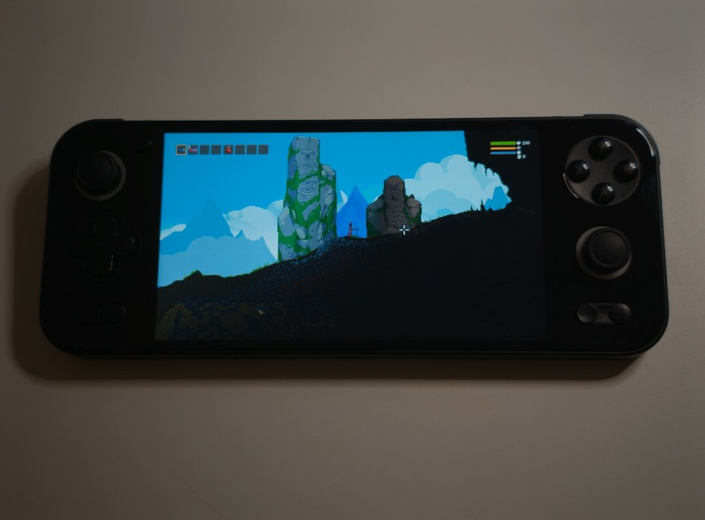

# noitadroid

**在 Android 上原生运行 Noita。** noitadroid 是 Noita 的 Android 原生移植（Noita 安卓版）：把 Windows 版 Noita 静态重编译成 ARM64，在 Android 掌机和手机上运行，不经过模拟器，也不用 Wine 或 Proton。它基于 [mina4mac](https://github.com/paulstraw/mina4mac)，后者为 Apple Silicon 的 Mac 做了同样的事。

[English](README.md)



在 AYANEO Pocket S（骁龙 G3x Gen 2，Android 13）上已经能玩：
- 1920×1080 全屏，前期洞穴 50–60 fps。
- 有完整的声音（FMOD），内置手柄和触屏都能用。
- 游戏内有菜单：存档导出/导入、手柄按键互换、FPS 和温度显示。

其他设备暂未测试，欢迎反馈。

> **APK 里不含任何游戏代码。** 你需要**自己在 GOG 上买的 Noita**。App 会在你的设备上，用这份游戏生成游戏的原生代码，大约 15 分钟，只需一次。这些代码是由游戏转换来的，只留在你自己的设备上，不要分享。整个过程不下载也不上传任何东西。

## 安装

需要准备：
- **GOG 上的 Windows 版 Noita**，版本 `20250125-1640`（2025 年 1 月 25 日）的离线安装包 `setup_noita_20250125-1640_(79502).exe`（一个 1.5 GB 的文件）。Steam 版不行，因为重编译出来的代码只对应这一个版本。
- **一台 Android 设备：**
  - arm64，Android 10 或更新，支持 OpenGL ES 3.0；
  - 构建时很吃内存，建议 8 GB 或以上（实测用的是 16 GB）；
  - 安装期间大约需要 5 GB 空闲空间，装好后占 2 GB；
  - 推荐用手柄。
- **可选，用于声音：** Android 版 FMOD Engine **2.01.x**。要在 [fmod.com](https://www.fmod.com/download) 注册免费账号后自己下载，因为它的许可证不允许 App 自带。没有它游戏也能玩，只是没有声音。

步骤：
1. **安装 APK**：从 [Releases](https://github.com/zhouwuqi/noitadroid/releases/latest) 下载。
2. **把 GOG 安装包放到设备上**，放在「下载」（Download）文件夹，或者存储卡的根目录。如果你想直接拷已经安装好的 Noita 文件夹（有 `noita.exe` 的那个），可以拷到「内部存储/noitadroid/Noita」；放在别处也行，在 App 里选中它的 `noita.exe` 即可。
3. **打开「Noita (noitadroid)」**，首屏会列出还缺什么：
   1. **所有文件访问权限。** App 从共享存储读取游戏，存档也放在那里。
   2. **从安装包安装。** App 先把安装包解包到「内部存储/noitadroid/Noita」（1–3 分钟），再构建游戏代码（骁龙 G3x Gen 2 上约 12 分钟）。期间处理器满负荷运行，设备会发热：请接上充电器，最好取下保护壳。可以切到别的 App，但不要从最近任务里关掉 Noita。构建中断的话，下次会从中断处继续。完成后 App 会提示可以删掉安装包。
   3. **声音（可选）。** 下载 **Android 版 FMOD Engine 2.01.23**（`fmodstudioapi20123android.tar.gz`，在 fmod.com 的版本列表里选 2.01.23），放进「下载」文件夹，点「导入」。导入后 App 会自动重启。
4. **开始游戏。** 之后打开 App 会直接进入游戏。

App 更新后，如果游戏代码需要的东西变了，会提示重新构建一次。

APK 的签名证书（SHA-256）：
`1A:5E:5E:78:98:01:E1:48:15:EB:19:62:95:7B:F1:65:13:F3:97:BB:97:FF:EC:45:DC:D4:5D:8D:98:7B:51:F5`。

## 原理

- **游戏本身：** mina4mac 的重编译器把 32 位 x86 的 `noita.exe`（以及 `msvcp120.dll`）转换成 C，再由 clang 编译成 ARM64。
- **在设备上：** App 自带一套工具链：
  - clang 和 lld（LLVM 21）；
  - 运行重编译器用的 Python 3.14；
  - 解包 GOG 安装包用的 innoextract。

  App 用它们在你的文件上运行重编译器，编译生成的约 400 MB C 代码，再把游戏库链接到 App 的私有目录。
- **运行时：** 它替代游戏用到的 Windows DLL，包括 kernel32 和 C 运行库，并桥接到原生的 SDL2、LuaJIT（含 ARM64 JIT）和 FMOD。
- **图形：** 游戏用的桌面 OpenGL 2.1 由 [gl4es](https://github.com/ptitSeb/gl4es) 转到 GLES 3.0 上运行。
- **Android 应用：** 游戏跑在 SDL2 的 Activity 里，外面还有：
  - 首屏，负责安装和构建；
  - 从左边缘滑出的游戏内菜单；
  - 游戏和存档都放在共享存储里，可以直接通过 USB 拷贝。

## 游玩

- **操作：** 手柄和触屏的用法与电脑版相同，触屏相当于鼠标。
- **游戏内菜单：** 从屏幕左边缘的中段往右滑。左边缘的其余部分留给系统手势导航的「返回」。菜单打开时游戏会暂停。菜单里有：
  - **存档：** 导出成 zip，目录结构和电脑版的 `Nolla_Games_Noita` 文件夹一致；也可以从这样的 zip 导入，Android 和电脑版的都行。当前存档会备份为 `save00.backup-日期`，然后游戏重启。
  - **手柄按键：** 为游戏互换按键，比如 A 和 B。游戏自带的设置里也能改各个操作的键位。
  - **FPS 和温度：** 在屏幕顶部显示一个小信息条。
  - **语言：** 应用自己的界面默认是英文，可以在这里或首屏切换成中文。游戏本身的语言在游戏设置里改。
- **设备上的文件：**
  - `/sdcard/noitadroid/Noita/`：游戏。
  - `/sdcard/noitadroid/save/AppData/LocalLow/Nolla_Games_Noita/`：存档，卸载应用后也会保留。
  - `/sdcard/noitadroid/noitadroid.log`：游戏日志，也可以用 `adb logcat -s noitadroid` 查看。
  - `/sdcard/noitadroid/build.log`：最近一次构建的日志。

## 故障排查

- **构建失败：** 首屏会显示原因，详细信息在 `/sdcard/noitadroid/build.log`。如果是内存不够，关掉其他应用再构建一次，会从中断处继续。
- **首屏说版本不对：** 你的 `noita.exe` 不是 GOG 的 20250125-1640 版。
- **没有声音：** 按上面的步骤导入 Android 版 FMOD 2.01.x，其他版本会被拒绝。
- **手柄有问题：** 在 `/sdcard/noitadroid/` 下放一个名为 `debug_input` 的空文件，日志里就会列出手柄和它们的轴。
- 其他问题：先看日志，再提 issue。

## 常见问题（FAQ）

### APK 里有游戏吗？

没有。APK 里只有重编译器、编译器和运行时，没有任何来自 Noita 的东西，也没有 FMOD。游戏代码是在你的设备上用你自己的游戏生成的，每个人都要自己构建。请不要分享 App 构建出的游戏代码（它放在 App 的私有目录里），也不要分享含有游戏代码的 APK。

### Steam 版能用吗？

不能。重编译出来的代码只对应一个版本的 `noita.exe`，也就是 GOG 的 `20250125-1640`。两个平台的游戏数据一样，但程序不一样。

### 我的手机或掌机能跑吗？

只要是 arm64、Android 10 或更新、支持 OpenGL ES 3.0、内存够构建用，大概率可以，但目前只在 AYANEO Pocket S 上测过。Noita 很吃 CPU，较新的骁龙芯片会更好。欢迎提 issue 反馈运行情况。

### 构建为什么要这么久？

重编译器会生成大约 400 MB 的 C 代码，设备要用自己的编译器把它们全部编译一遍。在骁龙 G3x Gen 2 上大约 12 分钟，只需一次。

### 能用 mod 吗？

游戏自己的 Lua mod 机制是能运行的（游戏自带的 mod 就是这样加载的），但其他 mod 在 Android 上还没怎么试过。需要原生 DLL 的 mod 和 Steam 创意工坊都不行。

### 能用电脑上的存档吗？

可以，但要是同一版本的 Noita：把电脑上 `%USERPROFILE%\AppData\LocalLow\Nolla_Games_Noita` 里的 `save00` 文件夹打成 zip，在游戏内菜单里导入；或者直接拷到设备上的存档文件夹。

### 为什么需要「所有文件访问权限」？

这样游戏和存档才能放在共享存储里：可以通过 USB 拷贝，重装应用也不会丢。

## 从源码构建

在 Linux x86_64 电脑上（Ubuntu 24.04 上验证过）：

```sh
sudo apt install git clang lld cmake ninja-build make innoextract openjdk-17-jdk libsdl2-dev libgles-dev libegl-dev
curl -LsSf https://astral.sh/uv/install.sh | sh        # 构建脚本用 uv 运行
sdkmanager "platform-tools" "platforms;android-36" "build-tools;36.0.0" "ndk;29.0.14206865"

git clone --recursive https://github.com/zhouwuqi/noitadroid
cd noitadroid
mkdir -p .local-deps
ln -s "$ANDROID_HOME/ndk/29.0.14206865" .local-deps/ndk
echo "sdk.dir=$ANDROID_HOME" > android/local.properties
tools/android/deps.sh                         # 把 Android 版 gl4es 和 SDL2 构建到 .local-deps
```

**APK**（不需要游戏）：

```sh
uv run tools/android/build_toolchain.py       # 设备上用的工具链：LLVM 大约要一小时、10 GB 空间
uv run tools/android/build_app.py --release   # 生成 build/android-app/noitadroid-<版本>.apk
```

如果有 `.local-deps/keys/release.properties`，release 版用里面指定的密钥签名，否则用 debug 密钥。

**内含游戏代码的开发版**：在电脑上用你自己的游戏构建，只装在自己的设备上：

```sh
innoextract --gog -d .local-deps/noita-gog "setup_noita_20250125-1640_(79502).exe"
export NOITA_DIR=$PWD/.local-deps/noita-gog
tools/android/setup_fmod.sh path/to/fmodstudioapi20123android.tar.gz   # 可选：声音
for m in noita msvcp120; do uv run tools/discover.py $m; done   # 只需一次
uv run tools/build_all.py                     # 把游戏重编译成 C（同时构建 Linux 版）
uv run tools/android/build_game.py            # 生成 build/android/noitadroid.apk，不要分享
```

更多：
- [docs/ANDROID.zh.md](docs/ANDROID.zh.md)：移植的开发笔记，包括设计、设备上的构建和设备测试。
- [docs/README.mina4mac.md](docs/README.mina4mac.md)：mina4mac 原来的 README，介绍重编译器和 macOS 版的构建。
- 运行时的测试也能在设备上跑：先运行 `tools/android/build_tests.sh`，再运行 `tools/android/device_check.sh`。

## 致谢与许可

- **mina4mac**：Paul Straw 编写，本移植所基于的重编译器和运行时，MIT 许可。
- **App 里附带的组件**沿用各自的许可，许可证全文在 APK 里（`assets/toolchain.zip` 的 `licenses/` 目录）：
  - [LLVM](https://llvm.org)（clang、lld；Apache-2.0，带 LLVM 例外条款）
  - [CPython](https://python.org)（PSF）
  - [capstone](https://www.capstone-engine.org)（BSD）
  - [pefile](https://github.com/erocarrera/pefile)（MIT）
  - [innoextract](https://constexpr.org/innoextract/)（zlib），以及它用到的 [Boost](https://boost.org)（BSL-1.0）、xz（0BSD）和 bzip2
  - Android 的 D8，以及 NDK 的 sysroot 和运行时库（Apache-2.0）
  - [SDL2](https://libsdl.org)（zlib）
  - [LuaJIT](https://luajit.org)（MIT）
  - [gl4es](https://github.com/ptitSeb/gl4es)（MIT）
- **FMOD** 遵循 FMOD 自己的许可，需要你自己下载。
- **noitadroid 自己的代码**和图标采用 MIT 许可，见 [LICENSE](LICENSE)。

Noita © Nolla Games。本项目与 Nolla Games、GOG、Firelight Technologies 均无关联，也未获得它们的认可。
